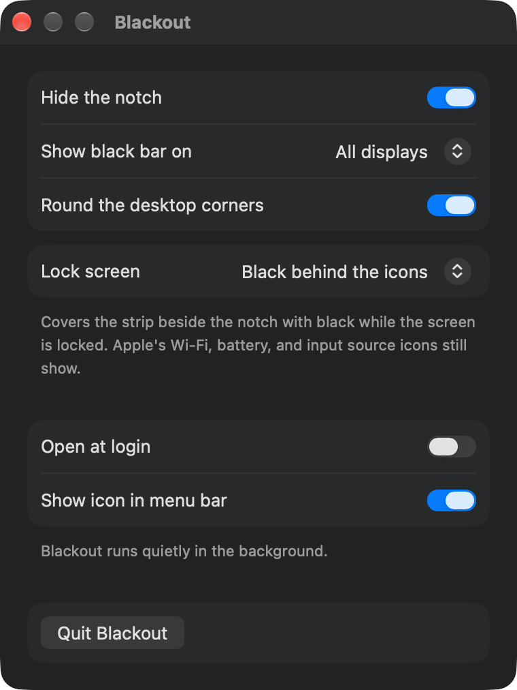

# Blackout

A free, open-source, telemetry-free menu bar app that hides the MacBook notch by
drawing a black bar behind the menu bar. Native AppKit, no network code, no analytics.

<p align="center">
  <picture>
    <source media="(prefers-color-scheme: light)" srcset="docs/screenshots/blackout-settings-light.png">
    
  </picture>
</p>

- **Show black bar on:** MacBook display only, or all displays (so every menu bar looks the same).
- Works with dynamic wallpapers, multiple displays, and Spaces: it draws behind the menu bar rather than editing your wallpaper, so nothing needs regenerating.
- Keeps the notch hidden in Mission Control and App Exposé, which draw a strip of their own over the menu bar.
- Keeps it hidden when macOS draws a menu bar background ("Show menu bar background" or Reduce transparency), following the menu bar as it slides with Spaces, full-screen apps, and Mission Control.
- Hides the notch on the lock screen too. By default the strip beside the notch turns black while the screen is locked, with Apple's Wi-Fi, battery, and input source icons still showing in it. Or Blackout can switch the display to the size that ends below the camera while locked. This needs Blackout running, so it doesn't apply to the login window at boot or the FileVault unlock screen. Choose in the settings window.
- Rounded desktop corners at the top and bottom, like the display's own. On by default; you can turn them off.
- Open at login, and an option to hide the menu bar icon entirely for set-and-forget use. With the icon hidden, open Blackout from Applications again to bring the settings window back.

Blackout draws beneath the menu bar. When macOS draws a background of its own there, with
**Show menu bar background** on (System Settings → Menu Bar) or **Reduce transparency** on
(System Settings → Accessibility → Display), Blackout also turns that background black from
above, keeping Apple's white text and icons. Colored menu bar icons show black then, except
the camera and microphone indicators. On a wallpaper light enough that macOS draws a light
menu bar with dark text, Blackout leaves it as is, so the notch shows there; in Light Mode
with Reduce transparency on that's always the case, and the settings window says so.

## Install

```sh
brew install --cask benjweaver/blackout/blackout
```

Or download `Blackout-<version>.zip` from Releases. Releases are signed with a
Developer ID and notarized by Apple, so macOS opens them without a warning.

## Build

```sh
brew install xcodegen
xcodegen generate
xcodebuild -project Blackout.xcodeproj -scheme Blackout -configuration Release -derivedDataPath build build
open build/Build/Products/Release/Blackout.app
```

Requires macOS 14+. Licensed GPL-3.0-or-later.

## Test menu bar transitions

`Scripts/vm-transitions/run.sh` runs Blackout in a macOS VM with "Show menu bar background" on and records the top of the screen through every transition that moves the menu bar: Mission Control, App Exposé, Show Desktop, full screen in and out, Space switches, and Notification Center. It does this on a range of wallpapers and prints wherever anything but black shows. The script's header says what the VM needs. The VM's display has no notch, so check the notch row on a notched Mac too.

## Support

Blackout is free. If it's useful, you can [support its development](https://benjweaver.dev/support/blackout).

## Icon

`swift Scripts/make-icon.swift` regenerates the app icon from code.

## Release

Bump the version in `project.yml`, add its section to `CHANGELOG.md`, then commit and
push. `Scripts/release.sh` does the rest: it builds a universal app, signs it with the
Developer ID, has Apple notarize it, publishes the zip as a GitHub release with that
changelog section as the notes, and points the
[Homebrew tap](https://github.com/benjweaver/homebrew-blackout) at it.

Notarizing needs an App Store Connect API key, saved once in the keychain as the
notarytool profile `notary`:

```sh
xcrun notarytool store-credentials notary --key AuthKey_<key id>.p8 --key-id <key id> --issuer <issuer id>
```
